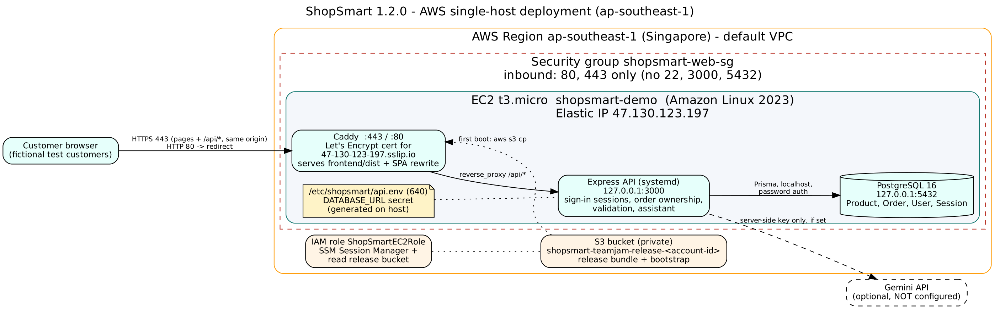
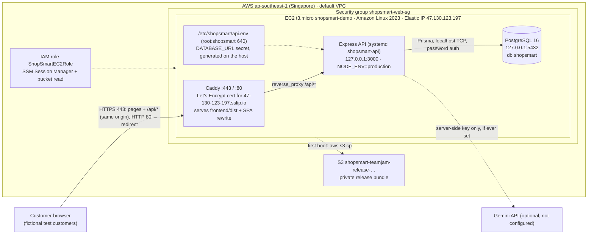

# ShopSmart AWS Deployment Record

**Team:** Team JAM · **Release:** 1.2.0 (sign-in + order ownership + AWS hosting) · **Date:** 20 November 2026
**Status:** **Hosted online** (fictional data and simulated checkout only)
**Site URL:** https://47-130-123-197.sslip.io
**Health:** https://47-130-123-197.sslip.io/api/health · **Readiness (checks the database):** https://47-130-123-197.sslip.io/api/health/ready
**Code version:** GitHub `Kishhh19/ShopSmart` commit `9a17af5` (release 1.2.0). The deployed bundle `shopsmart-release.tgz` was built from the same source; only documentation changed after it.

## 1. Account plan and credits (checked before creating anything)

| Item | Value (20 Nov 2026) |
| --- | --- |
| Plan | AWS **Free plan** ("Your free plan account does not get charged") |
| Credits | US$120.00 issued (US$100 Free Tier + US$20 Budgets), ~US$112.92 estimated remaining |
| Credit / plan expiry | 8 May 2027 (169 days remaining) |
| Estimated burn of this deployment | ≈ US$0.02/h: t3.micro ≈ US$0.0132/h + public IPv4 (Elastic IP) US$0.005/h + 8 GiB gp3 ≈ US$0.03/day → roughly **US$0.50/day, ≈ US$15/month** if left running |
| Note | ~US$7 already used before this deployment by an unrelated instance in Sydney (`sam10-helpwise…`). It was not touched. |

Redacted evidence: `docs/evidence/aws/00a_billing_credits_redacted.jpg` (credits, expiry) and `00b_billing_free_plan_redacted.jpg` (Free plan banner, USD 0.00 bill). Account ID, account name and credit IDs are blacked out; the bucket name below also hides the account ID.

## 2. Architecture decision record

**Decision:** Single EC2 host (Layout 1 in the learning guide).

| Considered | Why chosen / not chosen |
| --- | --- |
| **Single EC2 host** ✅ | One machine serves the built React app, runs Express and holds PostgreSQL. Fewest services to configure and explain for a short fictional-data demo; lowest credit burn; a real HTTPS certificate without buying a domain (Caddy + Let's Encrypt on an `sslip.io` name that maps to the Elastic IP). Frontend and API share one origin, so the session cookie works without cross-site settings. |
| Amplify + EC2 + RDS | Clearer separation, but needs a separate HTTPS API endpoint, cross-origin cookies/CORS, a private RDS instance and roughly 2–3× the credit burn. Better for a longer-lived release. |

**What the team accepts with this choice:** one machine is a single point of failure; the team maintains the OS, Node process, PostgreSQL, backups, HTTPS renewal (automatic in Caddy) and cleanup. Deleting the instance or its volume deletes the database.

**What would change for a longer-lived release:** move PostgreSQL to private RDS with automated backups, put the frontend on Amplify/CloudFront, buy a real domain, add CloudWatch alarms and a budget alert.

## 3. Deployment diagram

(`docs/aws_deployment_diagram.png`; the older `deployment_diagram.png` is the original Render proposal.)

| Port | Where | Public? | Why |
| --- | --- | --- | --- |
| 443 | Caddy | Yes | The only way users reach the app and API |
| 80 | Caddy | Yes | Redirects to HTTPS; Let's Encrypt HTTP challenge |
| 3000 | Express | **No** (127.0.0.1) | Raw API process stays behind Caddy |
| 5432 | PostgreSQL | **No** (127.0.0.1, not in SG) | Browser never talks to the database |
| 22 | SSH | **No** (not in SG, `sshd` disabled) | Admin access is SSM Session Manager through IAM instead |

## 4. Resource register

| Service | Name / ID | Region | Owner | Purpose | Created | Planned removal |
| --- | --- | --- | --- | --- | --- | --- |
| EC2 instance | `shopsmart-demo` · i-0f17f4551eb8aeeab · t3.micro | ap-southeast-1 | Mark Laurence Santos (Team JAM) | App + API + DB host | 2026-11-20 | After grading |
| EBS volume | 8 GiB gp3 root (deleted with instance) | ap-southeast-1 | Team JAM | OS + PostgreSQL data | 2026-11-20 | With instance |
| Elastic IP | 47.130.123.197 · eipalloc-0feb81427d8239796 | ap-southeast-1 | Team JAM | Stable public address / hostname | 2026-11-20 | **Release** after terminating (idle EIPs still cost) |
| Security group | `shopsmart-web-sg` · sg-0de4199655e873a03 | ap-southeast-1 | Team JAM | Allow 80/443 only | 2026-11-20 | After instance |
| S3 bucket | `shopsmart-teamjam-release-<account-id>` (private, Block Public Access on, bucket policy: read for ShopSmartEC2Role only) | ap-southeast-1 | Team JAM | Release bundle + bootstrap scripts | 2026-11-20 | Empty, then delete |
| IAM role + instance profile | `ShopSmartEC2Role` (AmazonSSMManagedInstanceCore) | Global | Team JAM | Session Manager access, read release bucket | 2026-11-20 | After instance |

No credentials, keys or passwords are recorded here.

## 5. Configuration (names and value classes only)

| Where | Name | Value class |
| --- | --- | --- |
| Frontend build | `VITE_API_URL` | Public: `/api` (same origin, so no rebuild if the IP changes) |
| API (`/etc/shopsmart/api.env`) | `DATABASE_URL` | **Secret**, generated on the server by `bootstrap.sh`, never leaves it |
| API | `NODE_ENV=production`, `HOST=127.0.0.1`, `PORT=3000`, `TRUST_PROXY=1` | Settings |
| API | `FRONTEND_URL` | Public, written at boot from the Elastic IP |
| API | `GEMINI_API_KEY` | **Secret**, intentionally empty: assistant runs as the labelled rule-based provider |

## 6. Migrations and data preservation

- Schema changes are committed migrations: `20260928040605_initial_schema` and new `20261120090000_add_users_sessions_order_owner` (adds `User`, `Session`, nullable `Order.userId`).
- The host runs **`prisma migrate deploy`** only. It never runs `migrate dev`.
- The seed ran **once** on the empty catalog (bootstrap checks `count(*) FROM "Product" = 0`). Later deployments skip it, and the seed itself refuses when orders exist or `NODE_ENV=production`.
- Tests run against a **separate** `shopsmart_test` database on the same host, never the live one.
- Backup before any future migration: `sudo -u postgres pg_dump shopsmart > /root/shopsmart-$(date +%F).sql`.

## 7. How to deploy an update

1. Build the bundle on a laptop: `tar --exclude=node_modules --exclude=.git --exclude=.env -czf shopsmart-release.tgz .`
2. Upload it to the release bucket (S3 console → Upload, same key).
3. Systems Manager → Session Manager → `shopsmart-demo` → `sudo bash /root/bootstrap.sh shopsmart-teamjam-release-<account-id> shopsmart-release.tgz`
   (keeps the DB and `api.env`, applies committed migrations, keeps the three newest releases for rollback: `ln -sfn /opt/shopsmart/releases/<old> /opt/shopsmart/current && systemctl restart shopsmart-api caddy`).

## 8. Hosted verification (20 Nov 2026, fresh browser, actual URL)

| Check | Expected | Observed | Result |
| --- | --- | --- | --- |
| Frontend and direct route | Home loads; refresh of `/products/2` shows the app | Home showed 6 products; direct visit to `/products/2` rendered the keyboard page | Pass |
| API connection | Browser calls same-origin HTTPS `/api`; health responds | `/api/health` 200 `{"status":"ok"}`; `/api/health/ready` `{"status":"ok","database":"ok"}`; HSTS header present | Pass |
| Catalog and cart | Current products, search, quantity, totals | 6 products from PostgreSQL; see screenshots | Pass |
| Account and order | Guest refused; owner succeeds; other customer denied by direct API request (guest visiting `/account` is sent to sign-in: evidence 10, 11) | Guest `GET /api/orders` 401, `GET /api/orders/1` 401, guest `POST /api/orders` 401 `SIGN_IN_REQUIRED`; owner `GET /api/orders/1` 200; second customer `GET /api/orders/1` **403 `ORDER_FORBIDDEN`**, own list empty; wrong password 401; cookie `HttpOnly` + `Secure` | Pass |
| Simulated checkout | Valid fictional order saved; invalid or excess refused | Valid order #1 201 (lamp stock 10 → 9); quantity 11 → 409 `INSUFFICIENT_STOCK`; bad details → 422 | Pass |
| Assistant | Claims match records; no-match and provider state clear | "keyboard below ₱2,000" → Compact Mechanical Keyboard ₱1,850 (matches DB), `provider: rule-based` shown in UI; "bicycles" → honest no-match, 0 products; 1-char question 422 | Pass |
| Restart and logs | API recovers; errors traceable without secrets | `systemctl restart shopsmart-api` → order #1 still readable (200); full instance reboot → see below; journald shows request lines only | Pass |
| Secrets and credits | No secret in repo, browser files or screenshots; credits in plan | `frontend/dist/assets` contains no `DATABASE_URL`/`postgresql://`/`GEMINI_API_KEY`; 0 matches for password/connection strings in API and Caddy logs; `.env` git-ignored; credits ≈ US$112.92 | Pass |
| Automated tests on the host | All pass | Backend `node --test`: 28/28 (incl. 5 new auth/ownership tests) on `shopsmart_test`; frontend vitest 16/16; ESLint clean; `prisma migrate status`: up to date | Pass |

## 9. End of the demo (cleanup order)

1. EC2 → terminate `shopsmart-demo` (also deletes the 8 GiB volume and the database; take a `pg_dump` first if needed).
2. EC2 → Elastic IPs → **release** 47.130.123.197.
3. EC2 → Security groups → delete `shopsmart-web-sg`.
4. S3 → empty, then delete `shopsmart-teamjam-release-<account-id>`.
5. IAM → delete role `ShopSmartEC2Role`.
6. Billing → Credits: confirm usage stopped.

## 10. Evidence index (`docs/evidence/aws/`)

| File | Shows |
| --- | --- |
| 00a / 00b | Billing: Free plan, credits and expiry (redacted) |
| 01 | Home page over HTTPS with products from PostgreSQL |
| 02 | Cart with quantity and total |
| 03 | Checkout asks a guest to sign in |
| 04 | Assistant answer matching the catalog, labelled rule-based |
| 05 | Hosted API checks: register, 409 excess stock, 422 bad details, 201 order, owner 200, other customer 403, guest 401, wrong password 401, HttpOnly + Secure cookie |
| 06 | API restart keeps the order; secret scan of logs and bundle; SSH off |
| 07 | After full reboot: services active, order kept, migration history |
| 08 | Tests on the host: backend 28/28, frontend 16/16 |
| 09 | Services and listening ports (API and DB on 127.0.0.1 only) |
| 10 / 11 | Sign-in page; guest opening `/account` is redirected to sign-in |
| 12 | Team member signed in through the website: My account page with name, email and Sign out |
| 13 / 14 | Signed-in customer: cart with total, product catalog with "added to cart" notice |
