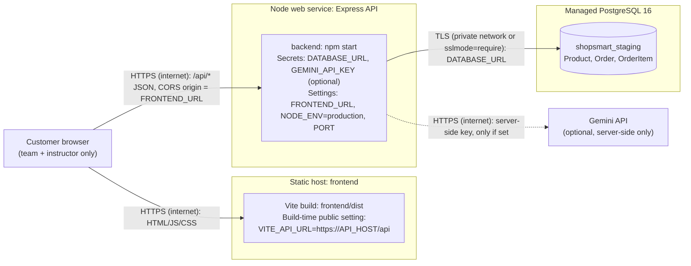

# ShopSmart Deployment Plan

**Status:** plan only. No staging site has been deployed. This release is a **local release candidate**.
The hosting platform below is a proposal and must be approved by the instructor. Platform commands must be checked against that platform's current documentation before use.

## Architecture

| Connection | Crosses the internet? | Configuration on that service |
| --- | --- | --- |
| Browser → frontend host | Yes (HTTPS) | None at runtime; the bundle is static |
| Browser → API | Yes (HTTPS) | API: `FRONTEND_URL` (CORS). Frontend: `VITE_API_URL` baked in at build time |
| API → PostgreSQL | Preferably no (same provider's private network); otherwise yes, over TLS (`?sslmode=require`) | API: `DATABASE_URL` secret |
| API → Gemini | Yes (HTTPS) | API: `GEMINI_API_KEY` secret. **Recommended for staging: leave it empty** (live AI not yet verified) |

## Answers to the plan questions

**1. Where will the Vite build files be hosted, and which API URL will the frontend use?**
On a static site host (proposal: a Render Static Site, or Netlify/Vercel if approved).
- Build command (from the repo root): `npm ci && npm run build --workspace frontend`
- Publish directory: `frontend/dist`
- Build environment variable: `VITE_API_URL=https://<api-host>/api`, for example `https://shopsmart-api-staging.onrender.com/api`. Vite compiles `VITE_` variables into the public JavaScript, so this holds only the public API address and never a secret.
- Add a rewrite rule `/* → /index.html` so that refreshing `/products/1` or `/checkout` does not return 404 (React Router handles routing in the browser).

**2. Where will the Express server run, and what public URL will serve `/api/health`?**
As a Node 22 web service (proposal: a Render Web Service) built from the same repository.
- Build command: `npm ci && npm run db:generate`
- Pre-deploy command: `npm run db:deploy` (see question 6)
- Start command: `npm start --workspace backend`
- The platform sets `PORT`; `server.js` already reads it.
- Health check path: `/api/health`, at `https://<api-host>/api/health`, which should return `{"status":"ok"}`.
- Because `/api/health` does not check the database, the smoke test must also call `/api/products`.

**3. Where will PostgreSQL run, and how will the server receive `DATABASE_URL` securely?**
On a managed PostgreSQL 16 instance from the same provider and region as the API (proposal: Render PostgreSQL, or Neon if approved), in a dedicated `shopsmart_staging` database that is separate from every laptop database.
The connection string is copied from the database dashboard into the API service's **secret environment variables** as `DATABASE_URL`. Use the internal/private URL where offered; otherwise add `?sslmode=require`. It is never put in the repository, in `frontend/.env`, in screenshots or in chat.

**4. Which origin will `FRONTEND_URL` and CORS permit?**
Exactly one origin: the static site's URL with no trailing slash and no path, for example `FRONTEND_URL=https://shopsmart-staging.onrender.com`. `app.js` passes this value to `cors({ origin })`, so the browser blocks API calls from any other site. Local development keeps `http://localhost:5173`.

**5. Where will a provider key be stored, and how is it kept out of the bundle and repository?**
Only as the API service's secret `GEMINI_API_KEY`. It is read in `backend/src/services/assistant.js` on the server. It never uses a `VITE_` prefix, so Vite cannot include it in the bundle. `.env` files are listed in `.gitignore` and `git ls-files` shows none tracked. After each build, search `frontend/dist/assets` for `GEMINI`, `DATABASE_URL` and `postgresql://` (the release check found none). Recommended hardening before using a real key: send it in the `x-goog-api-key` header instead of the URL query string, so it cannot appear in proxy or request logs.

**6. How will migrations be applied before first use without wiping orders?**
With the Prisma 6 production workflow, `prisma migrate deploy` (`npm run db:deploy`), run as the API's pre-deploy step on every release. It applies only committed migrations from `backend/prisma/migrations`, records them in `_prisma_migrations`, never generates new migrations and never resets data.
- **Never** run `npm run db:migrate` (`prisma migrate dev`) against staging. It is for local schema changes and can propose a reset.
- **Never** run `npm run db:seed` against staging once it holds orders. The seed now refuses when orders exist or when `NODE_ENV=production`. For first use, either run it once on the empty staging database from a laptop (temporarily pointing `DATABASE_URL` at staging, with `NODE_ENV=development`), or insert the six products in the database console.
- Before any later release with a new migration, take a database backup or snapshot.

**7. Who can access staging, and will only fictional data be used?**
Only the team and the instructor. The app has **no authentication**, so it must not be a public shop:
- Share the URL only with the instructor; do not post it publicly.
- If the platform supports it, add password protection to the static site or an IP allow-list.
- Display a notice on the site: "Classroom demo: use fictional names and @example.com addresses only."
- Only fictional customer details are used. Staging data is deleted after grading.

## Configuration checklist

| Service | Variable | Value / source | Secret? |
| --- | --- | --- | --- |
| Frontend (build) | `VITE_API_URL` | `https://<api-host>/api` | No (public) |
| API | `DATABASE_URL` | From the managed database dashboard | **Yes** |
| API | `FRONTEND_URL` | `https://<frontend-host>` | No |
| API | `NODE_ENV` | `production` | No |
| API | `PORT` | Set by the platform | No |
| API | `GEMINI_API_KEY` | Empty for staging (optional later) | **Yes** |
| API | `GEMINI_MODEL` | `gemini-2.0-flash` | No |

## Known deployment risks

| Risk | Mitigation |
| --- | --- |
| `express-rate-limit` behind a hosting proxy sees every user as the proxy's IP and logs `ERR_ERL_UNEXPECTED_X_FORWARDED_FOR` | Add `app.set('trust proxy', 1)` in `app.js` when deploying behind a single proxy, and verify it on staging |
| Free-tier API services sleep, so the first request can take 30 s or more | Open `/api/health` before the demonstration |
| SPA routes return 404 on refresh | Rewrite rule `/* → /index.html` |
| Health is `ok` while the database is down | Smoke test also checks `/api/products` |

## Staging smoke test (fill in only if staging is approved)

| Date | Frontend URL | API health URL | Health | Products | Cart | Checkout (fictional) | Assistant | Result |
| --- | --- | --- | --- | --- | --- | --- | --- | --- |
| | | | | | | | | |
